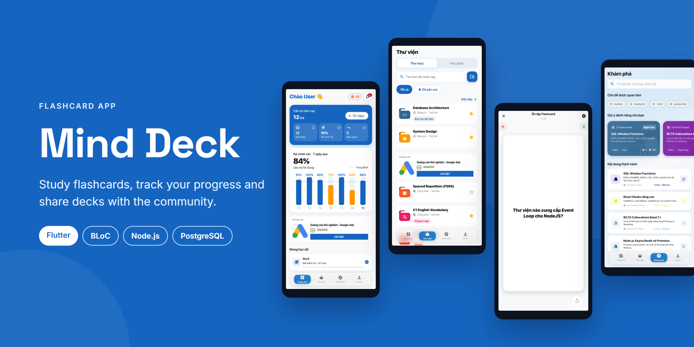
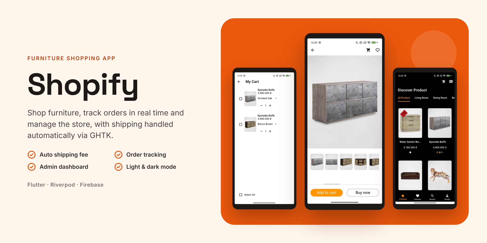
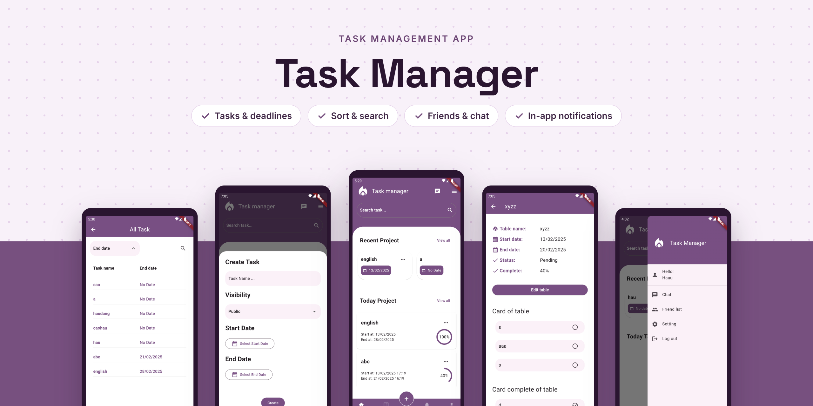
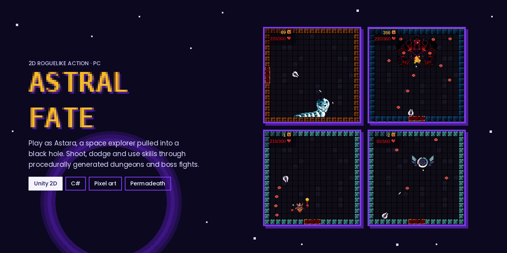
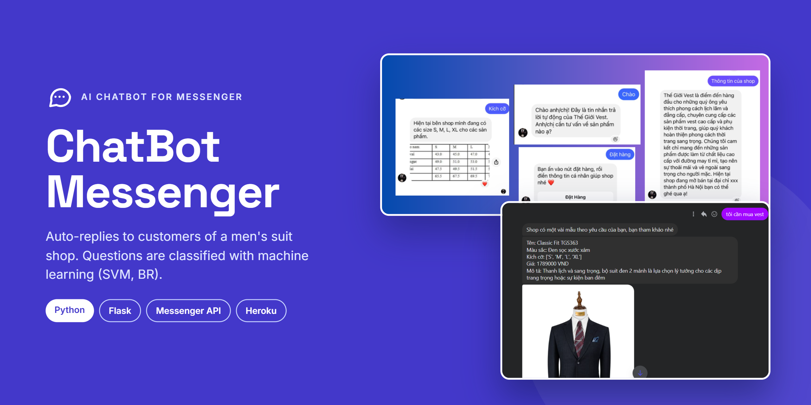
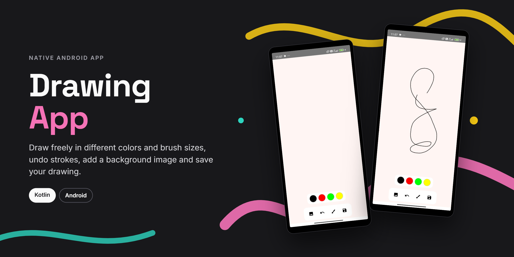

  

---

### 👨‍💻 About Me

- 📱 **Flutter Developer** based in **Hanoi, Vietnam** 🇻🇳
- 🚀 Shipped apps to **Google Play** & **App Store**
- 🧱 Love writing clean, maintainable code with **BLoC** & **Clean Architecture**
- 🌱 Currently learning **Backend Development** (Node.js, PostgreSQL)

 

---

### 🎯 What I Do

<table>
  <tr>
    <td align="center" width="33%">
      
       <b>Mobile Apps</b>
       Cross-platform Android &amp; iOS apps with Flutter
    </td>
    <td align="center" width="33%">
      
       <b>Clean Architecture</b>
       BLoC, MVVM and SOLID for code that scales
    </td>
    <td align="center" width="33%">
      
       <b>Backend Integration</b>
       REST API, WebSocket, Firebase, Node.js
    </td>
  </tr>
</table>

---

### 🚀 Tech Stack

**📱 Mobile Development**

**⚙️ Backend & Database**

**🛠️ Tools**

---

### 🌟 Highlighted Projects

<table>
  <tr>
    <th colspan="2" align="left"><h3><a href="https://github.com/DangCaoHau2004/mind_deck">📚 Mind Deck</a></h3></th>
  </tr>
  <tr>
    <td width="65%">
      
    </td>
    <td width="35%" align="center" valign="middle">
      
    </td>
  </tr>
  <tr>
    <td colspan="2">
      
      
      
      
       A full-stack flashcard app: create and study decks, and share them with the community. 🚧 Work in progress.
    </td>
  </tr>
</table>

 

<table>
  <tr>
    <th colspan="2" align="left"><h3><a href="https://github.com/DangCaoHau2004/ecommerce-shopify">🛒 E-commerce Shopify</a></h3></th>
  </tr>
  <tr>
    <td width="65%">
      
    </td>
    <td width="35%" align="center" valign="middle">
      
    </td>
  </tr>
  <tr>
    <td colspan="2">
      
      
      
       Furniture shopping app with real-time chat, product &amp; voucher management, automatic shipping fees and order tracking via GHTK. Light &amp; dark mode.
    </td>
  </tr>
</table>

 

<table>
  <tr>
    <th colspan="2" align="left"><h3><a href="https://github.com/DangCaoHau2004/task_manager_app">✅ Task Manager</a></h3></th>
  </tr>
  <tr>
    <td width="65%">
      
    </td>
    <td width="35%" align="center" valign="middle">
      
    </td>
  </tr>
  <tr>
    <td colspan="2">
      
      
       Task management app for individuals and teams: create, sort and search tasks, manage members, chat with friends and get in-app notifications.
    </td>
  </tr>
</table>

 

<table>
  <tr>
    <th colspan="2" align="left"><h3><a href="https://github.com/DangCaoHau2004/AstralFate">🔮 AstralFate</a></h3></th>
  </tr>
  <tr>
    <td width="65%">
      
    </td>
    <td width="35%" align="center" valign="middle">
      
    </td>
  </tr>
  <tr>
    <td colspan="2">
      
      
       2D roguelike action game for PC. Play as Astara, a space explorer trapped in a black hole: fight mutated monsters and bosses across 3 chaotic worlds to escape.
    </td>
  </tr>
</table>

 

<table>
  <tr>
    <th colspan="2" align="left"><h3><a href="https://github.com/DangCaoHau2004/chat_bot_messenger">💬 ChatBot Messenger</a></h3></th>
  </tr>
  <tr>
    <td width="65%">
      
    </td>
    <td width="35%" align="center" valign="middle">
      
    </td>
  </tr>
  <tr>
    <td colspan="2">
      
      
      
       Messenger chatbot for a men's suit shop: classifies customer questions with ML (SVM) and auto-replies via Meta's Messenger API.
    </td>
  </tr>
</table>

 

<table>
  <tr>
    <th colspan="2" align="left"><h3><a href="https://github.com/DangCaoHau2004/DrawingAppKotlin">🎨 Drawing App</a></h3></th>
  </tr>
  <tr>
    <td width="65%">
      
    </td>
    <td width="35%" align="center" valign="middle">
      
    </td>
  </tr>
  <tr>
    <td colspan="2">
      
      
       Native Android drawing app: draw in different colors and brush sizes, undo strokes, add a background image and save your drawing.
    </td>
  </tr>
</table>

 

### 📊 GitHub Analytics

<table align="center">
  <tr>
    <td width="58%" align="center"></td>
    <td width="42%" align="center"></td>
  </tr>
  <tr>
    <td colspan="2" align="center"></td>
  </tr>
</table>

---

